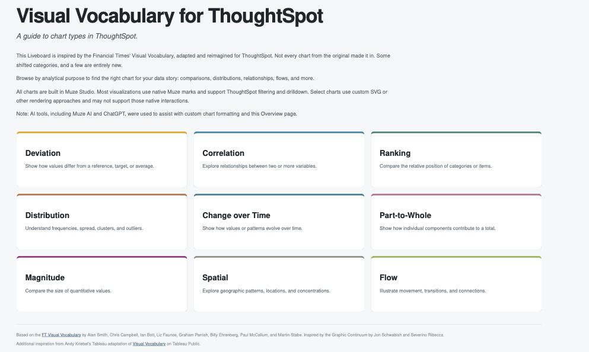

# Visual Vocabulary for ThoughtSpot

A collection of **50+ custom chart types built in ThoughtSpot Muze Studio**, organized by analytical purpose to help users explore different ways to visualize and understand data.

Inspired by the [Financial Times' Visual Vocabulary](https://github.com/Financial-Times/chart-doctor/tree/main/visual-vocabulary), [Andy Kriebel's Tableau Visual Vocabulary](https://public.tableau.com/views/VisualVocabulary/VisualVocabulary), and [Bibek Shrestha's ThoughtSpot Amuzing Chart Skills](https://github.com/BibekTS/Thoughtspot-Amuzing-chart-skills).

## Overview

The Visual Vocabulary is organized into nine categories:

| Category | Purpose |
|---|---|
| Deviation | Show how values differ from a reference, target, or average. |
| Correlation | Explore relationships between two or more variables. |
| Ranking | Compare the relative position of categories or items. |
| Distribution | Understand frequencies, spread, clusters, and outliers. |
| Change over Time | Show how values or patterns evolve over time. |
| Part-to-Whole | Show how individual components contribute to a total. |
| Magnitude | Compare the size of quantitative values. |
| Spatial | Explore geographic patterns, locations, and concentrations. |
| Flow | Illustrate movement, transitions, and connections. |

Each category includes **Standard and Advanced visualizations**, with descriptions explaining when and why to use each chart type.

## Preview

[View the complete Liveboard PDF](Overview/Visual_Vocabulary_for_ThoughtSpot.pdf)

## Getting Started

The project was developed using ThoughtSpot Muze Studio and the **(Sample) Retail - Apparel** data model.

**[Browse and download the Liveboard TML](TML/)**

To explore the Liveboard in your own ThoughtSpot environment:

1. Download the Liveboard TML file from the [TML folder](TML/).
2. Import the TML into ThoughtSpot.
3. Ensure the required data model and fields are available.
4. Review the imported Answers and custom chart configurations.
5. Adjust any data model references, formulas, or chart dependencies as needed.

> **Compatibility:** The TML was developed for a specific Sample Retail - Apparel environment. Importing it into another ThoughtSpot instance may require changes; cross-environment compatibility has not been fully verified.

## Chart Implementation

All visualizations were developed within Muze Studio.

- **Native Muze charts:** Most use native Muze marks and support ThoughtSpot filtering and drilldown.
- **Custom-rendered charts:** Some advanced visualizations use D3, SVG, or other rendering approaches and may not support native ThoughtSpot interactions.
- **Formatting:** Charts use category-based color palettes and consistent numeric formatting, tooltips, and legends where applicable.

The charts are examples intended as a visualization reference and starting point for customization. Chart files are organized in folders by analytical category.

## References and Inspiration

- [Financial Times - Visual Vocabulary](https://github.com/Financial-Times/chart-doctor/tree/main/visual-vocabulary)
- [Andy Kriebel - Visual Vocabulary for Tableau](https://public.tableau.com/views/VisualVocabulary/VisualVocabulary)
- [Bibek Shrestha - ThoughtSpot custom chart showcase](https://community.thoughtspot.com/s/feed/0D5TV00001BJ5j3?)

This project adapts the Visual Vocabulary concept to demonstrate additional visualization possibilities in ThoughtSpot.

## License

This product is licensed under MIT License.
See the [LICENSE](LICENSE) file for details.

## AI Assistance

Muze AI and ChatGPT were used to assist with custom chart development, formatting, and the Overview page.

## Feedback

Feedback, suggestions, and ideas for improving the chart collection are welcome. Feel free to [open an issue](https://github.com/braydenschut/visual-vocabulary-for-thoughtspot/issues).
